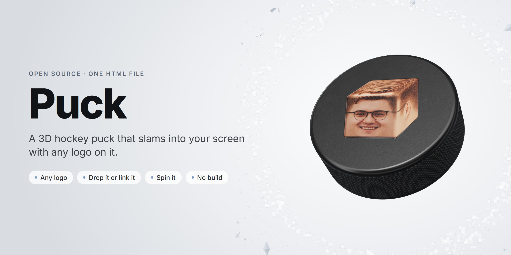

<p align="center">
  
</p>

<p align="center">
  <a href="https://puck.likemiens.com"><b>Live demo</b></a> ·
  <a href="media/demo.mp4"><b>Video</b></a> ·
  <a href="#change-the-logo"><b>Change the logo</b></a> ·
  <a href="#use-it"><b>Use it</b></a>
</p>

<p align="center">
  Made by Likemiens ·
  <a href="https://x.com/a_varantsov">X</a> ·
  <a href="https://t.me/Likemiens">Telegram</a> ·
  <a href="https://github.com/Likemiens">GitHub</a>
</p>

**Puck** is a 3D hockey puck for the web. It is shot at you from deep in the scene, slams into the screen, knocks ice and snow off the glass, bounces back and settles. Then you can grab it and spin it.

Put any logo on it: drop a file on the page or pass a link. It is one HTML file with three.js, no build step.

<p align="center">
  
</p>

## Features

- **A real puck.** 3″ × 1″ proportions, a moulded diamond grip on the side, rounded edges, satin rubber. Every texture is drawn in the browser when the page loads.
- **Any logo.** SVG, PNG, JPG or WebP. Colours stay as they are, black turns into white ink, and a white background disappears.
- **Drop it or link it.** Drag a file onto the page, or open the page with `?logo=` and an address or a preset name.
- **A shot with weight.** Ice chips and snow dust fly off the glass, a snow print fades on it, and the puck rebounds on springs.
- **Spin it.** Drag with a mouse or a finger and let go to throw it. The arrow keys work too. Afterwards it eases back into its pose.
- **Light.** One file, about 30 KB (11 KB gzipped), plus three.js from jsDelivr. It respects "reduce motion".

## Change the logo

### On the page

Open [puck.likemiens.com](https://puck.likemiens.com) and do one of these:

- **Pick a preset** in the bar at the bottom: Cubas, moai 🗿, skull 💀, clown 🤡, nerd 🤓 or sob 😭.
- **Drag an SVG or PNG** anywhere onto the page. You can also drag an image straight from another browser tab.

The puck gets the new logo and is shot again. A dropped file stays in your browser: nothing is uploaded.

### With a link

Add `?logo=` to the address:

| Link | Shows |
|---|---|
| `https://puck.likemiens.com/?logo=moai` | a preset by name: `cubas`, `moai`, `skull`, `clown`, `nerd`, `sob` |
| `https://puck.likemiens.com/?logo=https://example.com/logo.svg` | any image on the web |

- If the image address has a `?` or `&` of its own, encode it first with `encodeURIComponent(url)`.
- An image loads straight from its site when that site allows it (CORS). If it does not, the page fetches it through the [wsrv.nl](https://wsrv.nl) image proxy, which also turns SVG into PNG.
- If nothing arrives within 6 seconds, the puck shows Cubas and a short note.

> [!TIP]
> Best results come from an SVG, or from a PNG with a transparent background that is at least 1000 px wide.

### How a logo is printed

| In your file | On the puck |
|---|---|
| colours | the same colours |
| black and grey on a transparent background | white ink |
| white details inside a dark logo | bare black rubber |
| the plain background of a non-transparent picture | left out |
| a photo or a full-colour drawing on a transparent background | printed as it is |

Wide logos run across the face. Square and tall ones sit smaller, always clear of the edge.

### In your own copy

The presets are the `PRESETS` list near the top of the script in `index.html`, and the first one is the default:

```js
const PRESETS = [
  ['cubas', 'Cubas', 'presets/cubas.webp'],   // name for ?logo=, button title, file
  ['moai', 'Моаи', 'presets/moai.svg'],
  // …
]
```

Put your file in `presets/` and add a line for it. To make it the default, move that line to the top.

## Use it

### Share a link

Send `https://puck.likemiens.com/?logo=<your logo>`. Whoever opens it sees the puck fly in with that logo.

### Embed it on a site

```html
<iframe src="https://puck.likemiens.com/?logo=moai"
        title="A hockey puck with a logo"
        style="width: 100%; height: 600px; border: 0"></iframe>
```

### Host your own copy

```bash
git clone https://github.com/Likemiens/puck.git
cd puck
npx serve .
```

`python -m http.server` works just as well. Serve the folder over http(s), because a page opened straight from disk can't load the presets and the puck stays blank. Any static host will do: Vercel, Netlify, GitHub Pages or your own server.

### Controls

| Do | Get |
|---|---|
| drag with a mouse or a finger | turn the puck; let go mid-move to throw it |
| arrow keys (with the puck focused) | spin it |
| ↻ in the bar | shoot it again |
| a preset in the bar | print that logo and shoot again |
| drop a file | print it and shoot again |

With "reduce motion" turned on there is no shot: the puck is simply there, and you can still turn it.

### Tune it

These constants sit at the top of the script:

| Constant | Default | What it sets |
|---|---|---|
| `FLIGHT` | `0.85` | seconds from the shot to the glass |
| `FAR` | `34` | how deep in the scene the shot starts |
| `SHARDS`, `FLAKES` | `220`, `900` | ice chips and specks of snow dust at the glass |
| `R`, `H`, `F` | `1`, `2/3`, `0.06` | radius, thickness and edge rounding |

## How it works

- three.js r184 comes from jsDelivr through an import map. There is no bundler.
- The puck is two discs and a lathed wall. The diamond grip, the satin rubber and the raised ink are baked on a canvas into colour, roughness and normal maps. A new logo becomes the ink layer and the face is baked again.
- The light is a small studio of soft boxes rendered into an environment map. A black puck only shows its shape through what it reflects.
- The shot flies straight, flipping and spinning so that it reaches the glass with the logo upright. The rebound and the turn into the resting pose are springs. The ice chips are an instanced mesh, the snow dust is points, and the snow print on the glass is a fading plane.

## Browser support

It runs in current Chrome, Edge, Safari and Firefox, on desktop and on phones (WebGL 2). Drag and drop needs a desktop.

## Files

```
index.html     the whole thing
presets/       preset logos and the emoji licence
og.jpg         the link preview
media/         cover, demo video, animated preview
AGENTS.md      notes for coding agents
```

## Author

Made by **Likemiens**. Say hi or show your puck: [X](https://x.com/a_varantsov) · [Telegram](https://t.me/Likemiens) · [GitHub](https://github.com/Likemiens)

## License

The code is [MIT](LICENSE) © Likemiens. The emoji in `presets/` come from [Noto Emoji](https://github.com/googlefonts/noto-emoji) (see `presets/LICENSE-noto-emoji.txt`). The Cubas head is the author's own picture.
